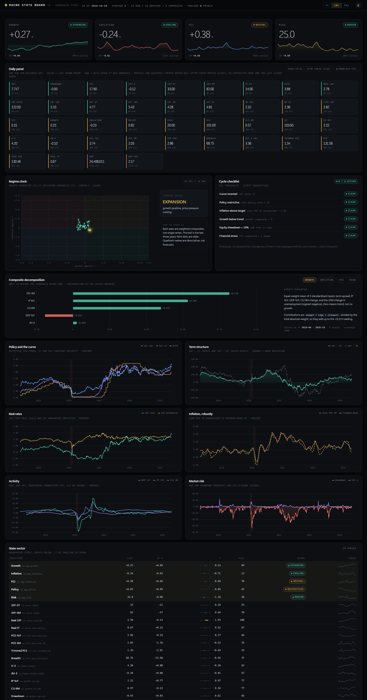

# Macro State Board

A bottom-up macro data platform: a point-in-time store at the bottom, auditable composite
indicators in the middle, and a dashboard that shows the aggregates — not a wall of
single indices.

The question it exists to answer:

> **Where are we in the cycle, and what does that imply for the next twelve months of returns?**

Everything on the board serves that sentence. Every aggregate can be decomposed into the
inputs it was built from, and every input can be traced to a provider, a series code and a
method note.



---

## Quick start

Windows, one click:

```powershell
.\run.ps1            # installs deps if needed, pulls data, starts the server, opens the browser
.\run.ps1 -Refresh   # force a full data refresh first
```

`run.cmd` is the same thing for double-clicking. On macOS/Linux use `./run.sh`.

Manual:

```bash
python -m pip install -r requirements.txt
export PYTHONPATH=src          # PowerShell: $env:PYTHONPATH = "src"
python -m macroboard init      # create the database
python -m macroboard refresh   # ingest -> panel aggregates -> transforms -> composites
python -m macroboard serve     # http://127.0.0.1:8765
```

The server also serves `/docs` (OpenAPI). Frontend and backend are separate deployables: the
frontend only ever talks to `/api/*`.

---

## Architecture: four layers, each derived from the one below

```
L3  state        regime label, checklist, signals        computed at read time
L2  composites   growth / inflation / financial / policy / risk
L1  derived      single-series transforms  +  panel aggregates
L0  raw          provider payload, untouched
```

**Why layers instead of one flat series list.** A dashboard of thirty single indices makes
the reader do the aggregation in their head, badly. Aggregating in code is reproducible,
auditable and arguable. The database keeps L0 and L1 precisely so that L2 never becomes a
black box.

### L0 — raw

19 series from key-less providers. Nothing is transformed at this layer.

| Group | Series | Source |
|---|---|---|
| Policy & curve | EFFR, 3M, 2Y, 5Y, 10Y, 30Y | Fed H.15 via DBnomics |
| Real rates | 10Y TIPS (H.15), 10Y TIPS par (GSW), 5Y/10Y breakeven | Fed H.15 / TIPS curve |
| Prices | core PCE, PCE, CPI YoY | BEA NIPA, OECD SDMX |
| Activity | real GDP, industrial production, OECD CLI | BEA, Fed G.17, OECD |
| Labour | unemployment rate | OECD harmonised |
| Market | S&P 500, VIX | Yahoo |

### L1 — derived and panel aggregates

Fourteen single-series transforms (curve spreads, YoY, 3M annualised, real policy rate,
drawdown, z-scores) **plus two aggregates built from a whole panel**:

- `us.infl.trimmed_3m` — trimmed-mean PCE inflation: each of 16 PCE price components is
  annualised over three months, the top and bottom 30% are dropped by count, the rest averaged;
- `us.infl.pce_diffusion` — the share of those components with positive 3M inflation.

Both come from one request to BEA table 2.8.4, and they are why the inflation panel can
answer "how broad is this" instead of showing one index.

### L2 — composites

Five aggregates, each defined in the `composite_input` table with explicit weights and signs:

| Composite | Inputs (weight, sign) |
|---|---|
| **Growth momentum** | 10Y−3M spread (1, +), IP YoY (1, +), GDP YoY (1, +), CLI 6M (1, +), Δunemployment (1, −) |
| **Inflation momentum** | core PCE 3M (1, +), trimmed-mean 3M (1, +), CPI YoY (0.8, +), 5Y breakeven (0.5, +) |
| **Financial conditions** | real 10Y (1, +), VIX z (1, +), S&P drawdown (1, −), 10Y−EFFR (0.5, +) |
| **Policy stance** | real policy rate (1, +), 2Y yield (0.6, +) |
| **Cycle risk** | growth (1, −), financial (0.8, +), policy (0.4, +) → percentile 0–100 |

Method: put every input on a monthly grid, standardise each over a trailing ten years, weight
and average. A composite is only emitted for months where at least 60% of its weight is
available — otherwise early history would be one series wearing an aggregate's name.

---

## What the board shows

- **Four aggregates** in the top row: growth, inflation, financial conditions, cycle risk.
- **Regime clock** — growth composite vs inflation composite in sigma, with a five-year
  trail. Quadrants are descriptive, not forecasts.
- **Cycle checklist** — six binary thresholds. The count is a readout, not a score.
- **Composite decomposition** — the signature panel: each input's contribution
  (`weight × sign × z`) to the current reading, so you can see *which* input moved the
  aggregate. Contributions sum to the composite value.
- **Six transmission charts** — policy, term structure, real rates, inflation (core vs
  trimmed mean), activity, market risk.
- **State vector** — aggregates first, inputs below; click any row for the series drawer,
  method note and full history.
- **Provenance** — every series, its provider, its code and its coverage.

Light and dark themes (`?theme=light`), and 3Y / 10Y / Max ranges that re-query the API.

---

## Point-in-time storage

Every ingest writes a new **vintage**; nothing is overwritten. Reads are vintage-correct:
`db.snapshot(vintage)` returns each series as it was known at that vintage, falling back to
the most recent earlier vintage for series the run did not refresh.

So a past view can be replayed exactly, and a revision shows up as a second vintage rather
than a silent overwrite.

### Daily panel

The observation table is period-based on purpose: a daily yield, a monthly PCE print and a
quarterly GDP figure are different kinds of fact. Analysis needs the opposite shape, so
`macroboard daily` projects everything onto one **business-day grid** and writes two wide
tables:

| table | shape | content |
|---|---|---|
| `daily_wide` | 27.5k rows × 40 columns | one row per business day, one column per series, forward filled |
| `daily_age` | same shape | how many days old that cell's source print is |
| `daily_column` | 40 rows | maps SQL-safe column names (`us_rates_ust10y`) back to `series_id` |

Two rules make it safe to use:

1. **No look-ahead.** A value enters the panel only once it is knowable: a daily close at the
   end of its own day, a monthly or quarterly print on the first day *after* the period it
   describes has closed. That is a lower bound on the real release date, and the only
   defensible rule without a release calendar.
2. **Age is a column, not a footnote.** `daily_age` lets you filter to "cells younger than
   five days" instead of silently regressing on a carried-forward GDP print.

The grid starts at **1990-01-01** by default. Industrial production reaches back to 1919, but
everything else does not, and a panel that is 95% empty for seventy years invites regressions
on carried-forward zeros. `python -m macroboard daily --start 1919-01-01` rebuilds the full
sparse history if you want it.

Because monthly prints only enter after the month closes, composites in the daily panel are
one month behind the dashboard's state readout, which deliberately uses the in-progress
month. That difference is stated here rather than smoothed over.

Endpoints: `GET /api/daily/tape` (latest day, with ages), `GET /api/daily?start=&end=&ids=`
(arrays, for analysis), `GET /api/daily.csv` (the whole table).

### What a vintage is

Every refresh writes a new **vintage**: a timestamped record of *what the world looked like
when we pulled it*. The observation table is keyed on `(series_id, period, vintage_id)`, so
the same month can hold several different values — one per vintage that saw it.

A concrete example. On 2026-10-20 the BEA print for August core PCE was `130.455`. Suppose
next month it is revised to `130.9`. After that refresh the database holds:

| series | period | vintage | value |
|---|---|---|---|
| us.prices.pce_core | 2026-08 | #1 (2026-10-20) | 130.455 |
| us.prices.pce_core | 2026-08 | #2 (2026-11-20) | 130.900 |

Nothing is overwritten. `db.snapshot()` returns the newest values; `db.snapshot(vintage=1)`
returns exactly what was on screen in October. That is what makes the board replayable —
and it is the difference between a backtest and a story, because a backtest run on revised
data is quietly cheating (this is the entire reason ALFRED exists next to FRED).

Vintages are stored as **deltas**. Vintage #1 holds the full history; every later one holds
only the rows that were new or revised since the previous vintage. A refresh that changes
nothing writes nothing, and one that picks up a week of prints writes a few dozen rows rather
than 220,000. Reads resolve the newest row per `(series, period)` with `vintage_id <= n`.

A real example from this database, not a hypothetical one. Vintage #1 pulled the S&P 500
level for 2026-10-20 at 15:00 UTC — 11:00 in New York, **mid-session**. Vintage #2 pulled it
again the next morning and stored `7712.57` against the earlier `7746.52`. The first number
was an intraday quote wearing a close's clothes; the second is the settlement. Without
vintages that correction would have silently overwritten history.

There are **five vintages** today: `#1` with 221,923 rows of history, `#2` with a 46-row
delta (38 new prints, 8 revisions), and three empty heartbeats from re-runs that found
nothing new. That last part is the point: a refresh that changes nothing costs nothing. It becomes useful once `refresh` runs on a
schedule: revisions then show up as a second vintage instead of silently changing history.

### Tracker

Revision history is not free: providers publish, revise, and never keep the first print.
`python -m macroboard track` runs once a day, records the latest print and its period for
every series, and counts what moved since yesterday. After a few months that table is a
first-print log that exists nowhere else — which is what `tracker` and `tracker_state` are
for. Schedule it with Task Scheduler (or cron) alongside a weekly `refresh`.

---

## API

| Endpoint | Purpose |
|---|---|
| `GET /api/overview` | aggregates, regime, checklist, state vector, notes |
| `GET /api/series?ids=a,b,c&years=10` | batch series (L0/L1/L2) |
| `GET /api/series/{id}` | one series, with composite inputs if it is an aggregate |
| `GET /api/catalog` | every series with layer, unit, source, method |
| `GET /api/meta` | vintage, layer counts, tracker status, recent runs |
| `GET /api/trackers` | today's prints and what moved |
| `GET /api/provenance` | source table |
'| `GET /api/daily/tape` | latest business day, every series with its data age |
| `GET /api/daily?start=&end=&ids=` | wide slice as arrays |
| `GET /api/daily.csv` | the whole daily panel |
| `GET /api/runs` | pipeline run log |'

---

## Data reality

A few things are structurally hard from this host, and the project states them instead of
papering over them:

- **The BLS blocks this IP** at `api.bls.gov` and `download.bls.gov` (403), and FRED times
  out. Labour therefore comes from **OECD's harmonised** series and CPI from **OECD's** CPI,
  not the BLS print. They are close but not identical, and the provenance column says so.
- **GDPNow has no machine-readable value** — the number exists only inside a chart image, so
  no tracker can collect it. It was tried, and removed rather than shipped broken.
- **Vintages start now.** There is one snapshot per run going forward and no historical
  vintage archive behind the first run. ALFRED-style revision analysis becomes possible only
  after the tracker has been running for a while.

---

## Layout

```
macroboard/
  src/macroboard/
    schema.sql          L0-L3 tables, tracker, composite definitions, run log
    db.py               vintage-correct reads/writes
    catalog.py          raw + derived + breadth + composite declarations
    providers/          dbnomics, yahoo, oecd adapters + http cache
    pipeline/           ingest, derive, breadth, composite, daily, track
    api/                FastAPI app + read model
    cli.py              init / refresh / serve / track / status
  web/                  static frontend (ECharts, no build step)
  data/                 SQLite database and provider cache (git-ignored)
  run.ps1 / run.cmd     one-click launcher
```

---

## Roadmap

1. **More panel aggregates** — an IP diffusion index across G.17 industries, and a
   principal-component financial-conditions measure instead of the hand-weighted one.
2. **Real vintages** — pull Philadelphia Fed RTDS real-time tables for CPI and GDP, which
   would give genuine "what was published then" history instead of starting from today.
3. **A scored model** — twelve-month recession probability from the composites, frozen
   walk-forward protocol, Brier/AUC against a random-walk baseline. The `model`,
   `model_output` and `model_score` tables are already there and deliberately unused: a model
   without an out-of-sample score does not go on the board.
4. **Conditional return distributions** — what the next twelve months of S&P returns looked
   like in each regime quadrant. That is where this project is ultimately heading.
